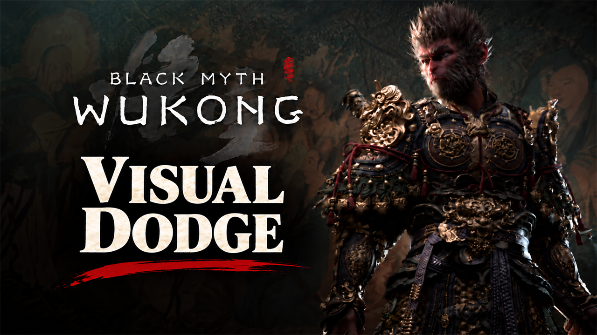

# Visual Dodge

Wukong's staff glows just before an enemy attack reaches you, timed to your reaction: your cue for a perfect dodge. Visual only.

## What it does

A perfect dodge needs a dodge press while the game's perfect-dodge window is open: the short time while an enemy's
attack warning reaches you. The game does not show that window, and it is short. This mod gives you a cue before it:

- It reads the enemy's attack animation and knows when the attack warning will reach you.
- Wukong's staff glows `ReactionSeconds` earlier (0.2 s by default), with one of the game's own staff glow effects.
  Press dodge when you see it: your reaction time brings the press into the window.
- Set `ReactionSeconds` to your own reaction time (see "How to use").
- Attacks that the mod cannot read ahead (projectiles, ground effects): the staff glows when the window opens.
- No glow when a perfect dodge is not possible at that moment (for example while you are grabbed).

It is a visual helper only: it reads the game's own data and changes nothing in play, so the window keeps its normal
length. It is a C# mod for C# Loader and changes no game files.

## Screenshots

## How to install

1. Install [C# Loader](https://github.com/KintaroModding/b1csharploader/releases/latest) v1.0.0 or newer:
   copy the `b1` folder of its zip into the game folder.
2. Download the zip of the latest release of this mod on GitHub (`wukong_visualdodge_<version>.zip`).
3. Copy the `b1` folder of the zip into the game folder, too. It adds the folder
   `b1\Binaries\Win64\CSharpLoader\Mods\wukong_visualdodge\`.
4. Start the game.

To check that it runs: the mod writes `wukong_visualdodge.log` into its folder, and with `Console=1` in
`CSharpLoader\b1cs.ini` the loader's console shows the line `[Visual Dodge] <version> loaded.`

To update the mod, copy the `b1` folder of the new release over the old one. To remove it, delete the folder
`CSharpLoader\Mods\wukong_visualdodge\`.

## How to use

Nothing to do: the glow shows up in fights as soon as you load a game. Press dodge when the staff glows.

`config.json` in the mod's folder sets the glow:

- `ReactionSeconds`: how many seconds before the attack reaches you the staff glows (0.2 by default). If your perfect
  dodges come too early, make it smaller; if they come too late, make it larger. `0` = the glow comes when the window
  opens.
- `FlashSeconds`: how long the glow lasts.
- `Clip`: which of the game's effects for Wukong it plays, for example `XuliBaofa/DBC_XuLi_Baofa_1` (the flash of a
  reached charge level, with its sound).
- `Enable`: `false` turns the glow off.

Changes apply at the next game start.

## Compatibility

- Game version: 1.0.21 (`1.0.21.23831`).
- Tested with C# Loader v1.0.1. The mod uses no hooks, so it does not need `EnableJit=1`.
- It only reads the game's data and changes no game files, so it should not conflict with other mods (not tested
  together with others yet).

## Known issues

- The staff can glow for an attack that then does not reach you, for example when you moved out of its range: then
  no window opens.
- Projectiles and ground effects get the glow only when the window opens, not before.

## How to build

The mod is a .NET Framework 4.7.2 DLL, built with the .NET SDK 8 or newer against the game's C# DLLs and the mod API of
C# Loader: `build.ps1 -GameDll <folder> -ModBase <file>`. `README.md` has the details.

## Credits

Made by Kintaro. MIT license: you may use, change and share this mod. C# Loader was created by
[czastack](https://github.com/czastack/B1CSharpLoader). Black Myth: Wukong belongs to its makers.
